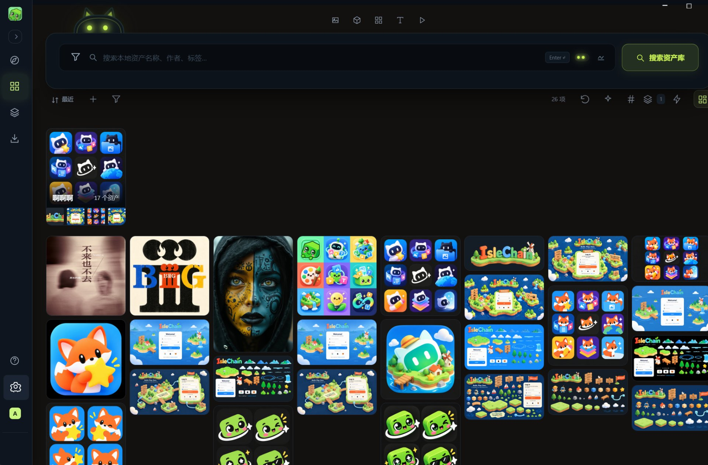
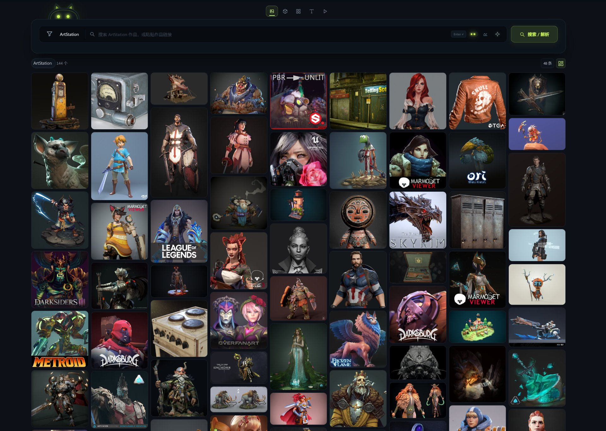

# Arvimo

**收素材、整素材、拼构图 —— 一个窗口做完。**

Arvimo 是一个本地优先的创作素材工作台（Windows 桌面版）。它把散在硬盘里、浏览记录里、收藏夹里的参考图和模型收进同一个库，筛出想要的那几张，再丢到无限画布上拼大色块、试构图。



## 能做什么

### 资产库

- **拖进来就入库**：单张、一批、整个文件夹都可以直接拖进窗口，图片 / 视频 / 3D 模型 / 材质 / HDRI / 资源包混着放
- **两种排法**：瀑布流（默认，按原始比例排）和网格，卡片尺寸随手调；点开就是大图 / 3D 预览
- **按想法筛**：类型、颜色、尺寸比例、标签、评分、收藏，也能用高级检索拼条件
- **批量操作**：框选一片、右键菜单、评分和备注，一次处理一堆
- **拖出去就能用**：拖到 Blender、Photoshop、资源管理器，直接当作文件交出去

### 发现

- 关键词搜索 Sketchfab、ArtStation 等平台的作品，也可以粘贴作品链接直接解析
- 看到合适的，一键收进本地库，和已有素材放在一起

### 画板

- 把同一个项目的素材归进一块画板，卡片**直接拖到画板上**即可加入
- **智能画板**存的是筛选规则，符合条件的新素材会自动进来，不用手动整理
- 一块画板对应一张画布，点开就能接着摆

### 画布

- 无限画布：参考图、模型截图、文字说明随便摆，做构图推演和大色块试验
- 和资产库双向联动：画布上能取库里的素材，库里也能一键跳到对应画布

### 其他

- **界面外观**：底色、背景图、面板不透明度，整套界面一起变
- **本地优先**：素材留在本机，账号之间互不可见；需要时可以开只读的局域网访客
- 托盘常驻，关窗口不打断后台任务

## 截图

| 资产库 | 发现与搜索 |
| --- | --- |
|  |  |

## 快速开始

需要 Windows 和 Node.js 20+。

```powershell
git clone https://github.com/ARTpace/Arvimo.git
cd Arvimo
npm --prefix apps/assetvault ci
npm --prefix apps/artflow ci
```

- 双击 `Start-Arvimo.cmd` 使用正式版
- 双击 `Arvimo 开发版.lnk` 使用开发版（改前端会自动重建并刷新窗口，改后端会自动重启服务）
- 双击 `Build-Arvimo.cmd` 生成安装包，产物输出到 `dist/`

## 仓库结构

```
Arvimo/
├── apps/assetvault/   # 素材库（资产库 / 发现 / 画板 / 设置，桌面壳在这里）
├── apps/artflow/      # 画布（无限画布宿主）
├── docs/              # 文档与截图
└── packages/          # 跨应用共享包
```

## 文档

- [画布与资产库的联动](docs/canvas-library-link.md)
- [设置页集成](docs/settings-integration.md)
