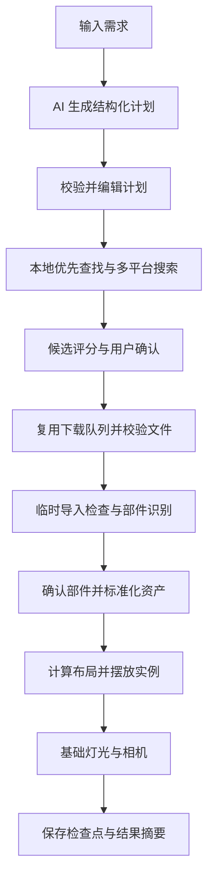

# AI 场景助手开发方案

状态：设计草案，尚未实现。适用项目：AssetVault 桌面端。日期：2026-10-20。

本方案的核心验收不是“AI 能调用 Blender”，而是“选中的资产适合需求、部件可可靠提取、组合后的场景满足空间与视觉约束”。软件直接接入 AI 为首选入口；MCP 后续作为同一场景任务服务的外部调用适配层，不另建编排与下载逻辑。

## 1. 目标与首版边界

用户输入场景描述，系统生成可编辑的资产清单，查找候选资源；用户确认后，复用下载队列，将模型导入 Blender，按规则生成可继续编辑的场景草稿。

首版产品定位：**基于资源包和场景模板的搭建助手**。先在用户选定、结构清晰的资源包内搭建，再扩展跨平台补件；全网自主寻找并组合任意模型不是首版目标。文中的在线搜索、四种布局和视觉迭代为分阶段能力，不要求首个版本同时交付。

首版验收示例：输入“低多边形庭院，中间一个喷泉，周围四张长椅、六棵树”，完成候选选择后，在 Blender 新建的专属 Collection 中得到数量正确、比例合理、基本不穿插的布局。

首版支持：静态模型、单个 Blender 会话、米制场景、中心/环形/网格/区域散布布局、基础地面、相机和灯光。允许缺少资产时保留占位物，提供重选入口。

首版优先使用独立模型，以及按对象或 Collection 清晰分件的资源包。需求拆解与模型拆件是两项不同能力：前者把文字需求变成槽位，后者从文件提取可组合的几何部件。焊接为整体的场景模型不属于首版自动拆件范围。

首版不做几何分割，包括按松散几何自动拆分后再语义聚合。需要这类处理的资源包标为不支持，允许用户在 Blender 人工整理后重新分析。

首版不承诺：任意描述自动生成成品场景、精确物理碰撞、复杂室内动线、角色动画、自动改拓扑、跨风格材质重绘、多个 Blender 实例自动调度。视觉评价和自动反复渲染放到后续阶段。

## 2. 核心原则

- AI 输出结构化计划，不直接执行任意 Python、Shell 或文件操作。
- 现有 AI 配置、搜索、下载队列和 Blender 桥接继续复用；不另建下载器或配置系统。
- 先预览计划和候选，再一次确认执行。用户后续在同一批准范围内重试不重复确认；增加数量、预算或资产来源时更新计划。
- 允许用户逐项替换资源、编辑数量、尺寸、朝向和布局。
- 每一步有状态、有错误原因、可取消；重试不重复下载或生成对象。
- 保留资产来源、许可与作者信息。“可下载”不等于可商用，不把未知许可标成商用可用。

## 3. 与现有工程的关系

以下为已存在能力，需在开发时确认具体入参，不能把本文的新增接口当成现成接口。

| 能力 | 现有实现 | 扩展方向 |
| --- | --- | --- |
| AI 配置、连接和结构化分析 | `server/ai.mjs`、`server/ai-search.mjs`、`src/library/ai-settings.js` | 增加场景计划生成与校验 |
| 多平台搜索 | `server/library.mjs` 的 `/api/search` 及各平台 search 路由 | 复用服务函数，按需求槽位检索；不依赖页面搜索状态 |
| 下载、去重、校验 | `server/downloads.mjs` | 场景任务引用下载任务 ID，监听既有状态 |
| 发送 Blender | `/api/downloads/tasks/:id/send-blender`、`server/blender-import.mjs` | 返回可定位的导入结果，支持场景归属 |
| Blender 常驻桥接 | `server/blender-bridge.py` | 增加对象查询、标准化、布局和清理命令 |
| 前端资产展示 | `src/library/card-view.js` | 复用候选卡片，不把临时候选自动收藏入库 |

桥接目前已有导入模型、材质、环境等操作；自动布局、任务回滚与下述协议属于新增能力。

建议新增 `server/scene-assistant.mjs` 负责场景任务编排，`src/library/scene-assistant.js` 负责工作面板。只有规则代码明显增长时才拆出布局模块，首版不引入代理框架、向量数据库或新调度服务。

## 4. 用户流程与界面

入口建议放在搜索栏 AI 菜单内，名称“搭建场景”。打开独立面板，不挤占常规搜索。

1. 描述：输入需求，选择场景尺寸、风格、资产数量上限和下载体积上限。
2. 计划：展示“主体、配景、地面、灯光”及数量、目标尺寸，允许编辑。
3. 候选：每个资产槽位展示最多三个优先候选，说明匹配原因、来源、许可、格式和已知大小。可优先选择本地资产或手动指定。
4. 执行：汇总唯一下载资源数、实例总数、已知体积与未知体积项，确认后开始。
5. 结果：显示缺失项、布局警告和 Blender 跳转入口，支持重试失败项、替换资产和撤回本次生成。

进度按真实阶段呈现，例如“已下载 3/5 个资源，已摆放 7/12 个实例”。总大小或处理时间未知时显示不定进度，不编造总百分比和剩余时间。

## 5. 任务流程



状态：`draft → planning → searching → awaiting_confirmation → downloading → inspecting → awaiting_parts_confirmation → importing → arranging → validating → completed`。

独立模型且检查无歧义时可跳过部件确认。低置信度拆件必须进入 `awaiting_parts_confirmation`，不能静默猜测后执行。检查和标准化在临时场景中进行，正式导入前仍需校验目标 Blender 会话和场景身份。

任一执行阶段可进入 `failed`、`cancelled`；部分资产失败且用户允许占位时，结果为 `completed_with_warnings`。恢复只能从已验证的检查点继续，不按一个笼统的“运行中”标记重跑全部步骤。

场景任务取消后停止自己的搜索与后续排布；共享下载任务若仍被其他场景或用户引用，不直接取消。已下载文件保留，已创建对象由用户选择保留或撤回。

## 6. 数据结构（新增协议草案）

场景计划需带 `schemaVersion`，校验后才能持久化和执行。下例尺寸单位为米，角度单位为度；Blender 内部转换为弧度。

```json
{
  "schemaVersion": 1,
  "id": "scene-uuid",
  "revision": 1,
  "prompt": "低多边形庭院，中间喷泉，周围长椅与树",
  "style": "low-poly",
  "bounds": {"width": 20, "depth": 16},
  "seed": 42,
  "limits": {"maxUniqueAssets": 8, "maxInstances": 30, "maxDownloadBytes": 1073741824},
  "slots": [
    {
      "id": "fountain",
      "label": "喷泉",
      "queries": ["low poly fountain", "stylized garden fountain"],
      "quantity": 1,
      "required": true,
      "targetSize": {"axis": "maxHorizontal", "meters": 3},
      "layout": {"rule": "center", "position": [0, 0, 0]},
      "selectedAsset": null
    },
    {
      "id": "bench",
      "label": "长椅",
      "queries": ["low poly park bench"],
      "quantity": 4,
      "required": false,
      "targetSize": {"axis": "width", "meters": 1.8},
      "layout": {"rule": "ring", "around": "fountain", "radius": 5, "face": "center"},
      "selectedAsset": null
    }
  ]
}
```

运行记录单独保存：`planRevision`、`state`、`confirmedRevision`、`downloadJobIds`、每个槽位的候选/选中资产、每个步骤状态、`blenderSessionId`、`sceneId`、检查点、错误和时间戳。

实例使用稳定标识，例如 `sceneId:slotId:index`。资产标识使用“平台 + UID”，不能仅用名称。文件身份参考现有校验指纹；多个实例共享同一份下载资源。

计划校验包括：数量和尺寸上限、有限数值、布局规则白名单、引用目标存在、引用关系无环、路径不可由 AI 指定、总实例数不超限。AI 输出不合法时只允许一次格式修复，再失败则保留可编辑草稿。

## 7. 查找与候选选择

在满足主题、完整性、许可和预算等硬条件后，优先顺序为：同一资源包 → 同一作者或系列 → 本地已校正素材 → 跨平台搜索。先在批准的来源范围内检索；扩大来源范围需更新计划。场景检索有独立请求状态和取消控制，不能覆盖用户正在浏览的搜索结果。

每个槽位首轮最多两条搜索词、每个平台一页；初始搜索并发上限建议为 2。优先按用户启用的平台执行，后续根据结果不足情况补查，避免一次场景触发大量 API 请求。

分两步筛选：

1. 硬条件：可取得兼容的模型文件、下载权限满足、格式受支持；用户要求明确商用许可时，未知许可不能自动选中。纯图片不能作为静态模型候选。
2. 相关性排序：主题匹配、风格、文件完整性、面数与体积预算、已下载可复用。通用的“3D、model、PBR”等词不独立构成主题相关性。

本地可复用是加分项，不能压过主题不匹配。平台分类属于召回条件，不视为准确性保证。先用标签、标题与类型筛选；仍无法区分时才对少量候选使用 AI 复核。视觉评分需要支持图片输入的模型，首版不依赖它。

不达阈值就标为“待选择”，不以不相关资产凑数。每个候选记录来源、选择理由及不确定项。平台原始标签与 AI 标签保持分开存储。

## 8. 下载与任务恢复

场景编排器直接复用下载管理服务，不通过模拟点击卡片入队。以平台、UID、输出规格复用下载任务，并在导入前重新确认文件存在与校验结果。

计划批准后记录批准版本。更换模型、增加数量或突破下载预算会让批准状态失效；纯位置微调可在原范围内执行。大小未知的资源明确列出，累计实际下载超过上限时暂停后续任务，不静默继续。

不把一个总任务永久挂在 HTTP 请求上。创建请求返回任务 ID，前端轮询快照即可，首版沿用项目现有方式，不额外引入消息服务。

场景任务存放在应用数据目录下的 `scene-tasks/`，沿用项目现有原子写入和单写者约束。不得把 AI Key、完整请求认证头写入计划、日志或 Blender 文件。

应用重启后，正在执行的步骤改为“待恢复”；确认 Blender 会话和场景仍匹配才继续。导入已成功但回执丢失时，先按实例标识查询对象，禁止直接再次导入。

## 9. Blender 协议与标准化

扩展现有本地桥接为白名单命令，每次请求包含 `requestId`、`sceneId`、`planRevision` 和协议版本。返回 `ok`、结果、警告或结构化错误。握手报告支持的能力和版本，旧桥接不支持布局时提示升级，不假装执行成功。

建议命令：

| 命令 | 作用 |
| --- | --- |
| `scene.inspect` | 返回 Blender 会话、当前场景和助手生成对象 |
| `scene.prepare` | 创建本次任务 Collection 和执行前检查点 |
| `asset.import` | 从后台核验的本地文件导入，返回稳定资产根对象标识 |
| `asset.normalize` | 计算包围盒、尺寸、底部与朝向校正 |
| `scene.arrange` | 按布局规则创建或更新指定实例 |
| `scene.preview` | 后续阶段导出预览图 |
| `scene.rollback` | 仅清理由本任务创建的内容 |

实际协议可沿用现有操作命名，不必为命名统一重写旧桥接。桥接仅监听回环地址，限制消息大小与文件路径范围，并采用应用与桥接握手验证；不得新增执行任意代码的入口。Blender 数据操作沿用主线程调度。

标准化顺序：

1. 将一次导入的所有网格及关联对象归入资产根节点，保留原有层级和材质。
2. 更新依赖图，使用变换后的可见几何计算整体包围盒。
3. 通过根节点等比缩放达到目标尺寸，不逐个改子网格以免破坏组合模型。
4. 校正根节点位置，让整体最低点落在地面。
5. 按用户确认的正面方向旋转；原点和包围盒无法可靠推断正面时标记待校正。
6. 缓存标准化数据：资源指纹、尺寸、缩放、底部偏移、正面方向和校正版本。

不强改当前场景的单位设置；内部以米表示并依据场景 `scale_length` 转换。空几何、尺寸为零、异常巨大或极小的模型必须报错或要求校正，不能生成无限缩放。

默认使用链接网格实例节省内存；用户要求逐件改材质或网格时再单独复制。导入组合物体以根节点为实例单位。

## 10. 布局规则

AI 负责选择规则和参数，确定性代码生成位置。相同计划和随机种子应得到相同布局。

| 规则 | 主要参数 | 示例 |
| --- | --- | --- |
| `center` | 位置、旋转 | 主体喷泉 |
| `ring` | 中心对象、半径、起始角、朝向 | 环形长椅 |
| `grid` | 区域、行列、间距 | 市集摊位 |
| `scatter` | 区域、密度、间距、种子 | 树木与石头 |

首版在平面地面工作，采用世界空间包围盒的水平投影做保守碰撞检测，预留间距与主体禁入区域。包围盒相交仅代表疑似碰撞，对组合件内部接触、桌面承托等声明过的接触关系不能一概拒绝。每个实例尝试次数有上限；放不下时返回缺失数量和原因，不无限随机重试。

规则依赖按拓扑顺序执行，例如先喷泉再长椅。用户手动移动的对象记录为锁定，后续重排默认跳过；可明确选择“重新生成全部布局”。

路径排列、靠墙布局和不平地形贴合延后实现，分别需要路线、墙面或地形的明确输入，不能靠模型名字推断。

## 11. 安全编辑、保存和撤回

每次生成使用 `AssetVault_<sceneId>` Collection，对象写入助手归属和实例 ID 自定义属性。不得按名称模糊删除对象。

执行前保存检查点：有文件路径的场景保存独立副本；未保存场景先要求指定检查点位置或明确使用新场景。不得覆盖用户原文件。失败时保留当前状态与报告，由用户选择恢复或仅移除生成内容。

撤回针对本任务创建的数据；共享网格、材质和用户已移出的对象不得盲目清除。全局 undo 不能替代持久检查点。生成结果另存为用户选择的 `.blend`，下载资源默认不删除。

## 12. 后端接口建议（均待实现）

| 方法与路径 | 作用 |
| --- | --- |
| `POST /api/scenes` | 创建草稿并启动计划生成，立即返回任务 ID |
| `GET /api/scenes/:id` | 查询计划、阶段和结果快照 |
| `PATCH /api/scenes/:id` | 提交经过版本校验的计划修改 |
| `POST /api/scenes/:id/search` | 查找候选，不执行下载 |
| `POST /api/scenes/:id/confirm` | 批准指定计划版本并启动下载与搭建 |
| `POST /api/scenes/:id/cancel` | 取消后续工作 |
| `POST /api/scenes/:id/retry` | 从指定失败检查点恢复 |
| `POST /api/scenes/:id/rollback` | 撤回该任务生成内容 |

写接口沿用现有本地请求校验。修改、确认和重试携带预期版本，版本不一致返回冲突，不覆盖较新的用户编辑。错误建议区分 `AI_UNAVAILABLE`、`INVALID_PLAN`、`NO_CANDIDATE`、`DOWNLOAD_FAILED`、`BRIDGE_OFFLINE`、`BRIDGE_INCOMPATIBLE`、`SCENE_CHANGED`、`LAYOUT_NO_SPACE`。

## 13. 开发阶段与交付顺序

### 阶段 A：模板计划与资源包选择

实现入口、庭院模板、AI 计划结构校验、可编辑槽位、资源包选择和本地资产复用。在线资源包由用户确认后下载；跨平台逐件补齐后置，不阻塞本阶段。

验收：模板生成正确清单；模板不支持的需求明确提示；可替换和删除槽位；无关候选不会自动入选；与普通搜索互不干扰；批准前不下载。

### 阶段 A2：资产理解与部件目录

先用一个已获授权、层级清晰的低模资源包验证对象识别、标准视角渲染、部件确认和可复用档案，再接入在线候选的下载后检查。此阶段必须早于通用自动搭景。

验收：能从包内识别完整长椅、树木和路灯，保留子网格与材质；不得将一张长椅拆成多件可独立摆放的“资产”。不确定的部件显示人工确认，不通过检查的候选不会进入布局。

### 阶段 B：自动场景草稿

基于已检查的部件档案，扩展桥接能力协商、幂等导入、尺寸校正、庭院所需布局、空间关系校验、局部修改、任务持久化、取消/恢复与检查点撤回。先实现中心、环形与外围散布，再按模板需要扩展网格。地面、灯光和相机使用固定模板，不消耗 AI 调用。

验收：庭院示例数量、比例和基本布局正确；断开桥接后可恢复；同一任务重试不重复导入；撤回不影响原场景。

### 阶段 B2：受控补件与更多模板

在资源包搭建通过验收后，开放缺失槽位的跨平台候选检索、有限重选和风格组合复核。街角、展台逐个作为独立模板交付，不把模板数量当成通用场景理解能力。

验收：同包存在合格部件时不无故外搜；候选尝试耗尽后留下明确缺失项；补件不会突破来源、下载或 AI 预算；用户手动修改保持不变。

### 阶段 C：视觉迭代

增加预览图、视觉模型评价与局部修改指令。默认最多两轮自动调整，每轮限制可修改对象，未改善时停止并展示结果；不做无限自主循环。

验收：支持“树木稀疏一点、相机靠近主体”等局部编辑；保留用户锁定对象；每轮可追溯、可撤回。

## 14. 验证清单

- 计划校验：非法 JSON、未知规则、负数/无限数值、超预算、循环布局依赖。
- 搜索：无结果、单个平台失败、分类过宽、纯图片混入、中文检索、本地文件失效。
- 下载：复用相同资源、不同输出规格、取消共享任务、离线、重启恢复、文件缺失。
- Blender：桥接离线/旧版、场景切换、回执丢失、多网格模型、不同单位、负缩放、错误朝向、零尺寸。
- 布局：固定种子可重现、边界不越界、间距约束、空间不足有明确警告。
- 数据保护：原场景对象和文件不变、撤回限定归属、路径范围校验、日志不含密钥。
- 桌面打包：从已安装应用完整执行，确认桥接脚本、任务目录和模型路径不依赖源码工程。

纯函数用 Node 测试；桥接协议用模拟器覆盖断连与幂等；阶段 B 必须补一次真实 Blender 集成验收，并在打包安装环境复验。静态检查通过不能替代真实场景搭建成功。

## 15. 成本与性能

每次计划尽量合并为一次 AI 请求；候选检索和布局用确定性代码。只向 AI 发送必要的名称、标签、格式及少量缩略图，不上传模型文件和完整用户资产库。计划缓存按描述、用户约束和协议版本失效；搜索缓存沿用现有机制。

记录 AI 调用数、耗时、唯一下载数、实例数、失败阶段和候选人工替换率，不凭感觉声称节省 Token。对较大资产设置面数、贴图及实例预算；真正的内存优化以实测 Blender 场景数据为准。

## 16. 推荐首个开发切片

首个纵向切片限定为“一个已授权且分件清晰的低模资源包 → 识别树、长椅、路灯 → 用户确认部件 → 生成庭院草稿 → 检查比例与通道”。先证明理解和组合可靠，再将在线搜索与下载接到同一条链路。阶段 A 的搜索面板可并行按独立功能交付，但不要以搜索结果好看代替真实模型可用性验收。

## 17. 资产理解：从搜索结果到可用部件

### 17.1 场景需求与资产选择合同

计划不仅列出“找什么”，还应定义部件角色、完整性要求、允许变化、目标尺度和空间关系。例：长椅应是完整可坐的独立物件，宽约 1.8 米，风格与喷泉一致，正面可校正，四件环绕主体且不占通道。不能把“bench 标签匹配”当成满足此合同。

按以下顺序选择，后一级不替代前一级：

| 阶段 | 输入与判断 | 输出与失败处理 |
| --- | --- | --- |
| 元数据筛选 | 类型、格式、许可、主题、资源预算 | 少量候选；无关或不满足硬条件直接拒绝 |
| 视觉初筛 | 缩略图/可获得的多视角图、已选主体风格 | 排序、可疑项；封面不能证明几何完整 |
| 下载后检查 | 临时导入、层级、几何统计、标准渲染 | 可用部件及档案；不合格退回候选选择 |
| 组合复核 | 所有已选部件的对比图与尺寸 | 组合是否协调，必要时替换某一项 |

下载后检查发生在已批准的下载预算内；替代候选导致新增下载时遵守第 8 节版本和预算约束，不能无上限试下载。

视觉判断关注主题、轮廓、完整性、风格、年代、细节密度、底座与背景、多余配件、贴图呈现。结果返回结论、依据、不确定项和拒绝原因，不只返回一个分数。AI 的置信度是参考，不视作统计概率；阈值必须通过固定样本集调校。

组合评分以“满足硬条件 → 主题适合 → 风格协调 → 性能预算 → 复用便利”为优先顺序。主体确定初始视觉方向，配景对照主体选取；没有主体时使用用户风格约束。不因已下载或点赞高而接受错误部件。

### 17.2 模型检查与标准预览

检查器在隔离的临时 Blender 场景执行，不改变用户当前文件。首版可使用独立后台 Blender 进程，限制一个检查并发、设置可配置超时，并记录退出和渲染错误。桥接负责正式场景编辑，检查进程不能与桥接同时修改同一场景。

读取对象父子关系、Collection、对象类型、可见几何数量、面数、材质与贴图引用、世界包围盒及异常变换。采用固定中性背景、固定相机规则生成正面、侧面、背面、顶面或等角预览，并保留材质视图；对象自动取景，预览不能截断几何。

实际几何检查与视觉识别分开保存。仅凭图像无法证明背面完整、贴图文件齐全、真实世界尺寸或功能可用；缺失证据记为 `unknown`。AI 推测的尺寸和正面方向也需标记来源，不能伪装成模型元数据。

AI 配置增加能力声明或探测：文字计划需要结构化文本输出，视觉识别需要图像输入。未配置视觉模型时仍可做确定性检查和人工选件，但明确标为人工模式，不能声称已经自动视觉复核。

## 18. 资源包拆件与资产档案

### 18.1 提取策略

| 结构 | 首版处理 | 限制 |
| --- | --- | --- |
| 独立对象/Collection，语义清晰 | 以层级和整体渲染形成候选部件 | 名称只是线索，仍检查完整性 |
| 单对象内多个不连通部分 | 首版不自动拆分，人工整理后重新分析或换候选 | 后续才研究分离与聚合；连通块不等于语义部件 |
| 多个物件焊成连续网格 | 标记不支持自动提取，换候选或人工拆分 | 后续几何分割研究，不列入首版承诺 |
| 含骨架、约束或复杂实例系统 | 首版提示人工处理或换静态候选 | 不破坏关联后声称拆件成功 |

先判断哪些节点构成一个完整部件，再提取。依据包括父子层级、空间邻近、组合预览与名称；材质相同不是同部件的充分条件。LOD、碰撞代理、隐藏装饰和重复展示样本应标记用途，不能混入可摆放物件。

提取保留相对变换、材质、依赖贴图及来源关系；在临时数据中操作，原下载文件只读。不能为了“底部贴地”破坏模型内部层级。

### 18.2 部件档案草案

```json
{
  "schemaVersion": 1,
  "partId": "part-uuid",
  "source": {"platform": "local", "uid": "pack-uuid", "fingerprint": "sha256"},
  "selector": {"collectionPath": ["Park", "Bench"], "objectPaths": []},
  "label": "长椅",
  "role": "seating",
  "style": ["low-poly", "stylized"],
  "geometry": {"boundsMeters": [1.8, 0.6, 0.9], "meshes": 5},
  "normalization": {"forwardAxis": "-Y", "upAxis": "Z", "scale": 1, "groundOffset": 0},
  "anchors": [],
  "checks": {"geometry": "passed", "textures": "passed", "completeness": "needs_review"},
  "review": {"status": "pending", "evidence": [], "warnings": []},
  "analysisVersion": 1
}
```

选择器只对对应文件指纹有效，路径由检查器产生，不由 AI 任意填写。`anchors` 可记录底面、正面、支撑面等，必须注明自动测量、AI 推断或用户校正来源。许可继承源资产并保留原始文本，不因拆件改变授权。

档案与缩略图存在应用数据目录下 `asset-analysis/`，和场景任务分开。缓存键包含文件指纹、分析版本和提取配置；模型改变则失效，用户校正单独保留并提示复核。用户可修正部件边界、正面、尺寸和语义标签，确认后后续场景复用。

首版不需要向量数据库：用部件标签、类型、检查状态和风格字段检索。只有样本规模和召回评估证明不足，再引入向量检索。

## 19. 场景关系、合理性检查与有限修正

计划增加关系约束，至少包含 `subject`、`relation`、`target`、参数与是否硬约束。例如 `bench → face_toward → fountain`、`tree → avoid → walkway`。首次实现支持 `around`、`face_toward`、`inside`、`avoid`、`on_ground`；`supported_by` 等承托关系暂只记录，未实现的关系必须返回能力不足，不能静默忽略。

用户尺寸、数量和通道要求为硬约束；随机旋转、视觉密度和构图偏好可设为软约束。地面、通行区、主体禁入区在计划里有明确几何定义。规则使用部件占地范围和预留间距计算，不只比较对象原点。

检查分为两层：

- 确定性检查：实例数量、越界、悬空、异常比例、禁止穿插、朝向及通道占用。记录容差和判定依据，首版包围盒检查只称“保守检查”。
- 视觉检查：俯视图检查分布，最终相机图检查主体、遮挡、密度与风格。图像评分不能推翻硬约束失败。

修正以结构化补丁提交，注明目标实例、原因及预期改善，只允许在已批准计划范围内调整位置、旋转和尺度。阶段 B 先做确定性修正与报告；阶段 C 增加最多两轮视觉修正。硬约束无法满足时退回编辑，不发布“已完成”。用户锁定的物件保持不动。

## 20. 证据、评估与上线门槛

建立小型固定样本集：至少包含独立长椅、多网格组合长椅、树叶分散的树、带底座摆件、贴图缺失模型、包含 LOD 的资源包和焊接整场景。用户确认的部件边界与相关性作为基准，不依赖 AI 自评。

首版记录候选相关率、人工换件率、完整部件识别率、误拆率、缓存命中率、下载浪费量、布局硬约束通过率、重复实例数与撤回完整性。指标定义及目标在样本基线建立后确定，不能虚构准确率。

最低可发布条件：固定庭院样例中，已确认部件数量正确；重试产生零重复实例；没有未解决的越界/地面悬空/通道堵塞；撤回不改变原场景；不支持的拆件明确拒绝；未知信息与人工确认项可见。在线平台与安装包环境分别验收，保留计划、部件证据、最终预览和失败记录。

## 21. 候选失败与有限尝试

默认每个槽位最多尝试三个不同候选（含首次选择），同一资源文件内切换部件不重复计算下载量，但仍记录检查成本。该上限是初始产品默认值，可在任务开始前调整；自动执行期间不得自行增加。

网络瞬时错误可沿用现有下载重试策略，同一资产重试不算新的候选。主题错误、缺少几何、贴图损坏等确定性问题不对同一文件反复重试，直接记录原因并进入下一个候选。

任务同时限制唯一资源数、总实例数、实际下载字节、AI 请求次数、视觉分析图片数与检查耗时。未知大小资源单独提示；无法中断的单文件传输可能超过预算，界面必须说明这是软预算还是已实现的硬限制，未实现流式中断前不能承诺严格字节上限。

达到任一上限则进入 `needs_attention`，保留已完成部分。用户可选择接受部分草稿、保留占位、手动指定模型或增加预算。不允许后台无限搜索或试下载。

必需槽位缺失时不能标为完整成功；用户明确接受占位后可生成 `completed_with_warnings` 草稿。占位物显示槽位名和目标尺寸，不伪装成已找到的模型。

## 22. 模板与人工校正

模板以 `templateId`、`templateVersion` 持久化，定义必需/可选槽位、允许的布局规则、主体区域、通道、留白、镜头和灯光预设。AI 只能填写该模板支持的参数，不通过生成脚本扩展模板。重跑使用原模板版本，升级需显式迁移。

第一个模板只做低模庭院；街角与展台后续单独验收。用户输入不属于已有模板时推荐最接近模板或保留需求草稿，不强行声称支持。

部件确认面板提供四个最小操作：选正面、输入参考尺寸、调整底部、确认部件范围。显示原始测量、推断值和用户覆盖值；未知真实尺寸不能只凭包围盒自动确定。

校正保存到对应指纹的部件档案，所有引用场景共享可见，但已生成的场景不会因档案变更而静默缩放。用户选择“应用新校正”时才创建新计划版本并预览影响。

## 23. 用户修改与局部编辑合同

对象记录助手上次应用的变换、部件版本和归属。执行前对比当前状态：用户改过的位置、尺寸、旋转默认锁定；材质、网格和父子关系发生变化则标记外部修改，首版不自动重写。删除的实例不能因刷新任务快照而自动复活。

“树多一点”先生成只影响树槽位的补丁，展示新增/移动/删除数量。其他槽位、用户对象及手动修改保持不动。增加数量或下载量超出批准范围时按新版本确认；纯位置调整在原范围内可直接执行。

“重排全部”是独立操作，先列出影响范围。确认后也只处理当前任务明确拥有且未排除的对象。对父级有外部改动的对象，不能仅恢复子对象变换。

将草稿补丁、应用结果和回滚基准持久化。遇到任务版本或场景变化则返回冲突，重新读取并展示差异；不能用重新搭建整个场景代替局部编辑。

## 24. 响应速度与成本边界

优先复用人工确认的部件档案。新文件先做确定性检查，对陌生或有歧义的部件才调用视觉 AI；不默认给资源包中每个碎片渲染多视角。先渲染部件联系表，少数难判项再生成独立视角，仍遵守图片和检查预算。

任务开始前显示预计的分析步骤、已知资源体积和预算，不虚构准确等待时间。执行时逐步展示已识别部件和可用草稿，提供跳过视觉分析改为人工确认的入口。取消后终止排队中的渲染和 AI 请求；已发出且供应商不能取消的请求明确说明仍可能计费。

缓存区分几何测量、标准预览、AI 语义分析和用户校正。更换 AI 模型只失效相关语义结果，不重下载模型或重做无关几何检查。缓存失效原因在日志中可追溯，不通过无限刷新增加成本。

补充上线用例：候选耗尽、预算达到上限、用户修改后局部补件、模板版本更新、无视觉能力时人工流程，以及取消检查后的进程回收。先测量真实耗时与人工换件率，再确定性能目标。
