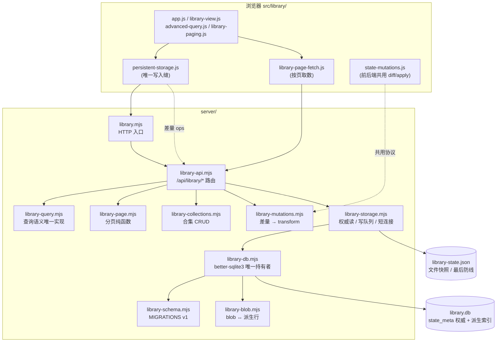

# 资产库开发文档（路线 B：抄内核，不抄 UI）

> 本文回答三件事：**为什么这么设计**、**哪些契约不能随便改**、**加功能该动哪里**。
> 「功能 → 文件」索引见 [CODEMAP.md](CODEMAP.md)（AI 首读），目录规范见 [project-structure.md](project-structure.md)，许可证见 [THIRD_PARTY.md](THIRD_PARTY.md)。
> 文中源码路径均相对仓库根目录。适用基线：`SERVER_VERSION 3.15.0`（智能收集画板服务端 P0+P1） / schema v1 / 2026-11-07。
> **画板体系与智能收集的独立契约、并行任务切分见 [画板体系与智能收集画板开发文档](board-development.md)**；本文只管通用内核，改 `boardId` / `/api/collect/*` / `collect-rules.json` 之前先读那份。

---

## 0. 一页速览

| 项 | 现状 |
| --- | --- |
| 形态 | Node ESM 本地服务 + 原生 JS 浏览器前端 + Tauri 桌面壳；原本零运行时依赖、整块 JSON blob 持久化 |
| 路线 | **B：复用 Serpent 的数据层设计（schema / 查询语法 / 协议 / 算法），不搬 Electron + React UI** |
| 已完成 | 阶段 1~4（SQLite 内核 → 查询与合集 → 分页与排序 → 差量写入与按页取数）+ 桌面版原生依赖装配 + 格式注册表 + 封面探测元数据 + 图标条 8 个维度的真实筛选能力 |
| 内核 | `better-sqlite3` + FTS5 `trigram`，声明式迁移链 v1，原始 blob 字符串仍是权威 |
| 双引擎 | DB 可用走 `sqlite`；不可用退回 `memory`（结果同形），此时合集/智能合集明确 503 |
| **总根问题** | **数据所有权仍在浏览器 `state.models` 整块 blob**：启动整块 GET、下载入库整块 POST 都没拆 |

一句话：现在检索与组织能力已接近专业库，但**权威层、安全层、输入生态层**还没过线。下一步该动的是数据所有权，不是再堆功能。

---

## 1. 决策背景

### 1.1 三条路线的取舍

| 路线 | 做法 | 为什么没选 / 选了 |
| --- | --- | --- |
| A 零代码打通 | 直接把 Serpent 的 DB 当外部服务读 | 多一套 Electron 进程、数据模型与现有前端 state 不通，等于维护两个库 |
| **B 抄内核（选定）** | 把 schema、查询语法、合集协议、分页算法移植到 `server/`，前端低侵入 | 复用成熟设计、保留既有 UI 与零依赖传统、前端契约不变、可逐步演进 |
| C 整栈重写 | 跟着 Serpent 换 Electron + React + TS | 5 万行内核 / 60 条迁移 / 完整 UI 全部重做，与「复用优先」相悖 |

### 1.2 借鉴边界与许可

- 参考源：`H:\AI-Tools\Serpent`（MIT）。实际移植的只有 `src/shared/search-expression.ts`（91 行纯函数，见 `server/search-expression.mjs`）与 `library-service.ts` 的 `MIGRATIONS` 思路、合集/智能合集数据模型；**没有整文件搬运**。
- AssetVault 主体为 GPL-3.0-only；并入 MIT 代码必须保留原许可声明，已登记在 [THIRD_PARTY.md](THIRD_PARTY.md)（`better-sqlite3` / `bindings` / `file-uri-to-path` 三个 MIT 包及随包位置）。
- 明确不做：不引入 Electron / React / TS，不复制 Serpent 的插件系统、WebDAV、语义索引实现，不改前端业务模块（`app.js` 对存储层零感知）。

### 1.3 设计总纲（主人铁律）

1. **复用优先**：先找成熟方案，再包适配层，最后才自研最小薄封装。
2. **不写死**：阈值进配置、算法走策略、业务只依赖抽象、清单数据驱动、接口带版本缝。
3. **契约先行**：内核签名 / 协议字段 / 事件名 / schema 先冻结，多个 AI 才能并行开工。
4. **目录可定位**：一个模块一个文件，单文件 ≤300 行（硬红线 400），新增/移动文件同步 `CODEMAP.md`。
5. **测试有层级**：生产目录禁放测试，测试全在 `test/`，命名 `<被测模块>.test.js`，探查脚本进 `scratch/<日期>_<主题>/` 用完即弃。

---

## 2. 架构分层

| 层 | 唯一实现 | 职责 | 禁止事项 |
| --- | --- | --- | --- |
| 展示 / 交互 | `src/library/*` | 网格绘制、面板、事件 | 不直接 fetch 存储接口、不拼合集 id |
| 前端持久化 | `persistent-storage.js` | `setItem()` 自动 diff、串行写队列、失败重放 | 不放过 `_remoteOnly` 写回、不绕过整块重放 |
| 协议 | `state-mutations.js` | 前后端**同一套** diff / apply / 校验 | 禁止另写「服务端版过滤」 |
| HTTP | `library.mjs` + `library-api.mjs` | 路由分发、本地 + 同源守卫、状态码 | 不在这里写第二套查询规则 |
| 查询语义 | `library-query.mjs` | 行归一化、过滤、排序、分页 | 禁止另写 SQL 版过滤 |
| 存储 | `library-storage.mjs` | 权威读取、写队列、原子落盘、索引同步 | 不做业务语义判断 |
| 驱动 | `library-db.mjs` | 迁移、读写、FTS、短连接 | 业务代码禁止 `import 'better-sqlite3'` |
| 契约 | `library-schema.mjs` / `capabilities.mjs` / `search-expression.mjs` | schema、能力位、检索语法 | 历史迁移 / 已发布字段只加不改 |

### 2.1 三条数据通路

| 通路 | 流程 | 关键不变量 |
| --- | --- | --- |
| **启动读** | `GET /api/library-state` → `storage.load()` → `authoritative()` → DB 优先、文件比 DB 新则先重建索引 | `state_meta` 返回**原始字符串**，与前端 blob 字节级一致 |
| **查询** | `POST /query` 或 `GET` / `POST /assets` → `dataset()` → `normalizeRows()` → `queryAssets()` → `{total, items, uids}` | SQLite 与内存降级必须产出**同形行**；`uids` 默认全量命中，`uidScope:'page'` 只回本页 |
| **写入** | `setItem()` → `diffMainState()` → `POST /mutations` → `mutationTransform()` → `storage.mutate()` → `applyMutations()` → `commitValues()` | 主 blob 永远由**服务端权威值 + ops** 生成；任何失败整块重放并关闭差量通道 |

`commitValues()` 是整块写与差量写共用的落盘点：先写 `library-state.json.tmp` 再 `rename` 原子替换，随后同步 DB 索引；DB 写失败只告警，文件快照仍有效，下次 `ensureIndex()` 靠 `snapshot_at` 自愈。

---

## 3. 契约层（改动必须串行 + 版本提升）

> 这一节是「多 AI 并行开发」的冻结面：**冲突量 ≈ 共享面 × 变更频率**。改这里的任何一项都要走「ADR 说明 → 提升版本/能力位 → 加兼容层」，且一次只由一个 owner 串行执行；模块内部实现可以并行。

| 契约 | 定义处 | 主要消费方 |
| --- | --- | --- |
| 主状态键与字段 | `library-schema.mjs` `STATE_KEYS` / `MAIN_STATE_KEY`；`src/library/state-mutations.js` | 前端 `persistent-storage.js`、服务端存储层 |
| SQLite schema | `library-schema.mjs` `MIGRATIONS` | `library-db.mjs`、`library-collections.mjs` |
| HTTP 路由与出入参 | `library-api.mjs` `ROUTES` | 前端面板 / MCP / 脚本 |
| 检索语法与排序 | `search-expression.mjs` `ALIASES`；`library-query.mjs` `SORTS` | 查询层、前端语法提示 |
| 差量 op 协议 | `state-mutations.js` | 前端写入缝、服务端 `library-mutations.mjs` |
| 能力位 | `capabilities.mjs` `SERVER_CAPABILITIES` | 启动器 `start-library-background.mjs` |
| 原生依赖闭包 | `copy-sqlite-native.mjs` `RUNTIME_PACKAGES` / `PACKAGE_LAYOUT` | 桌面打包链路 |

### 3.1 数据权威与 schema（v1）

权威 / 派生分离是整套内核的地基：

- `state_meta` 存前端原始 blob 字符串（**权威**，保证 `GET /api/library-state` 字节级一致）；
- `assets` / `tags` / `assets_fts` 是从 blob 派生的**可重建索引**，任何时候都能整批重建；
- `collections` / `collection_assets` / `smart_collections` 是**真实持久化数据**，`writeValues()` 绝不清空。

| 表 | 内容 | 可重建 |
| --- | --- | --- |
| `schema_migrations` | 版本号 + checksum + 应用时间 | 否 |
| `state_meta` | `key → 原始字符串` | 否（权威） |
| `db_meta` | `snapshot_at` 等内部戳 | 否 |
| `assets` | uid / position / state / payload(JSON) / 常用检索列 | 是 |
| `tags` | `(uid, kind, tag)`，kind ∈ platform / ai / user | 是 |
| `assets_fts` | FTS5 `trigram` 虚表（uid UNINDEXED + body） | 是 |
| `collections` / `collection_assets` | 合集 + 成员 uid 与 `position` 手动顺序 | 否 |
| `smart_collections` | 规则（query / filters / sort），内容每次重算 | 否 |

迁移规则：

1. `MIGRATIONS` **只加不改**，每条 SQL 带 SHA-256 checksum；`planMigrations()` 发现历史 checksum 不符直接拒绝打开库。
2. 待执行迁移在**一个事务**内跑完，迁移失败先 `db.close()` 再抛（否则 Windows 上 `.db` 被句柄锁住）。建表 SQL 必须先 `exec` 再 `prepare` 插入迁移记录。
3. 首次迁移前备份 `library-state.pre-db.json`。
4. 连接策略：**短连接**（每次 load/save/query 开→用→关）+ WAL + `busy_timeout=3000`；`close()` 接口保留，供将来换长连接时无需改调用方。
5. `db.pragma` 与 `Database` 构造函数由 `createLibraryDb()` 注入，测试不碰真实数据目录。

### 3.2 前端 state 契约

| 键 | 用途 |
| --- | --- |
| `sfx-library-v2` | **主状态**：`version` / `models` / `favorites` / `aiTags` / `userTags` / `userMeta` / `trashed` / `history` / `tasks` / `options` |
| `sfx-discovery-v1` | 检索现场（搜索结果 / 分页） |
| `sfx-library-ui` | UI 偏好（视图、列宽、主题等，跨重启持久化） |
| `sfx-local-index-v1` | 本地文件索引 |

- uid 一律 32 位十六进制字符串；`userMeta` 固定 `{rating:0..5, note:string}`。
- `LIBRARY_LIMIT = 20000`（资产条数**唯一**阈值）、`MAX_STATE_BYTES = 16MB`，散落的 1000 上限已收拢。
- `_remoteOnly` 是按页取数临时补进 `state.models` 的**只读显示标记**，`saveLibrary()` 必须持续过滤，绝不写回 blob。
- `state.models` 保持全量：分页只发生在 `paintGrid()` 之前，裁数据会让评分 / 标签 / 回收站 / 全选丢数据。

### 3.3 HTTP API 契约

所有 `/api/library/*` 请求都要带 `X-SFX-Local: 1`；带 `Origin` 时必须与 `Host` 同源，否则 403（LAN 访问者与跨站页面不能读写资产库）。

| 方法 | 路径 | 主要入参 | 返回 / 说明 |
| --- | --- | --- | --- |
| GET | `/api/library-state` | — | `{values, recovered, scanIndex}`，启动整块读（**尚未拆**） |
| POST | `/api/library-state` | `{key: 原始字符串}` | 整块写；服务端 merge 保留未提交的键 |
| POST | `/api/library/mutations` | `{ops, values?}` | `{saved, applied, incremental, engine, schemaVersion}`；`values` 只放小 key，**不得带主状态** |
| POST | `/api/library/query` | `{q, filters, sort, limit, offset}` | `{total, limit, offset, items(卡片), uids(全量命中), engine, mode:'uids'}` |
| GET | `/api/library/query/status` | — | `{available, engine, counts, schemaVersion, sorts, fields, syntax}` |
| GET / POST | `/api/library/assets` | 同 query，`uidScope:'page'` | `mode:'page'`，`items` 是**完整 model**；`total` 仍为完整命中数 |
| GET / POST / DELETE | `/api/library/collections` | `{id?, name?, ...}` | 列表 / 新建（id 由服务端生成）/ 删除 |
| POST | `/api/library/collections/items` | `{id, uids, action}` | `add` / `remove` / `set`（整组替换）/ `reorder`（传入顺序优先，其余按原 position 跟在后面） |
| GET / POST / DELETE | `/api/library/smart-collections` | `{name?, q, filters, sort, smart}` | 规则存表，内容重算 |
| POST | `/api/library/smart-collections/resolve` | `{id, limit, offset}` | 按存的规则跑一次查询 |

状态码：`400` 非法差量 / 主状态格式无效（服务端先 dry-run 再进写队列）；`403` 守卫拒绝；`404` 智能合集不存在或老进程无路由；`405` 方法不对；`409` 状态不可写；`500` 其它读写失败（含 JSON 解析失败、请求过大）；`503` **合集/智能合集在纯文件模式下不可用**（检索不打折，但不假装成功）。

### 3.4 检索契约

**语法**（移植自 Serpent，用户手册可复用）：空格 = AND、`|` = OR、`-词` = 排除、`"短语"` = 精确、`\` 转义、`field:value` 限定字段。解析结果 `clauses`（组内 AND）或 `groups`（组间 OR）。比原版多保留一个 `quoted` 标记：引号内的 `tag:foo` / `-foo` 按字面量处理。

| 别名（`ALIASES`） | 规范字段 | 取值 |
| --- | --- | --- |
| `name` `filename` `title` | `name` | 行 name |
| `tag` `tags` | `tags` | 三层标签合并文本 |
| `desc` `description` `note` `comment` | `note` | 备注 |
| `link` `url` `source_url` `source` | `url` | 链接 |
| `author` `artist` | `author` | 作者 |
| `path` `folder` `folder_path` | `path` | filePath / root / rel / folder |
| `meta` `metadata` `metadata_text` | `metadata` | 完整 model JSON + 备注 |
| `platform` `site` | `platform` | 平台 |
| `category` `kind` `type` | `category` | 分类 + 资产类型 |
| `ext` `extension` `format` `filetype` | `format` | `row.formats` 后缀 + `row.formatGroups` 分组 id，**精确匹配**（`ext:png` 不命中 `.pngx`） |
| `rating` | `rating` | 数值：`4` / `>=4` / `4-5` / `<3` |

- 过滤维度：`state` / `rating` / `favorite` / `tags` / `platforms` / `kinds` / `categories` / `downloadable` / `uids` / `collection` / `formats`（配 `excludeFormats`）。**跨维 AND、同维 OR**；格式维度的 token 语义见 3.9。
- `SORTS` 共 **8** 种：`recent` `oldest` `name` `rating` `popular` `position` `collection` `random`；`collection` 依赖 `collection_assets.position`，由 `state.queryOrder` 传给网格，前端不再二次排序。
- `DEFAULT_QUERY = {q:'', sort:'recent', limit:60, offset:0}`；`limit` 夹在 1~500。
- **双引擎同形行**：`normalizeRows()`（DB）与 `rowsFromState()`（blob）产出同形行，`test/library-query.test.js` 锁死一致性。换引擎不改结果，也禁止另写一套 SQL 过滤。
- **FTS5 只是预筛**：`simpleFtsTerm(q)` 是启用加速的**唯一**判据 —— 只有 ≥3 字的单个正向纯文本词才用 `assets_fts` 缩候选集，最终仍由 `queryAssets()` 完整求值。带字段 / 排除 / OR / 短语 / 2 字中文词的查询一律走全量（trigram 对 2 字词不成立，退回 LIKE 又会漏 tags）。`FTS_CANDIDATE_LIMIT = 20000`。

### 3.5 差量写入契约

协议实现在 `src/library/state-mutations.js`（纯函数、零 IO、前后端共用），服务端翻译在 `server/library-mutations.mjs`。

| 项 | 规则 |
| --- | --- |
| op 形状 | `{op:'set', field, key?, value}` / `{op:'delete', field, key}` |
| 键级白名单 | `MUTABLE_MAPS = ['aiTags','userMeta','userTags']`（key = 32 位 uid） |
| 整键白名单 | `MUTABLE_VALUES = ['favorites','history','tasks','options']` |
| 永不进 op | `models` / `trashed` / `version` / 任何未知字段 —— 一变就退回整块 `/api/library-state` |
| 阈值 | `MAX_MUTATION_OPS = 800`、`MAX_MUTATION_BYTES = 96KB`；附带 key 按 32KB 分流单独整块提交；`/api/library/*` 的 `readBody()` 上限 128KB（整块 `/api/library-state` 另按 `MAX_STATE_BYTES × 2` 限流） |
| 语义 | **绝对赋值**（不写 `+1/-1`），因此幂等、无需版本协商；两个标签页改不同资产不会互相覆盖 |
| 校验 | `validateMutationValue()` 前后端共用（uid 格式、rating 0~5、note ≤2000、标签 ≤100 项 / 每项 ≤200 字等） |
| 服务端 | `mutationTransform()` 先干跑一次再进写队列，主状态格式无效抛 `MutationRejectedError` → 400；`storage.mutate()` 与整块 `save()` 共用同一串行队列 |
| 降级 | 老进程 404/405 → 永久关通道；任何异常 → 整块重放 + `onWarn` 上报 `assetvault:storage-error`，绝不丢数据 |

### 3.6 按页取数契约

`createPagedQuery()`（`src/library/library-page-fetch.js`）：`first()` / `more()` 走 `POST /assets` 带 `uidScope:'page', limit:60, offset`；`generation` 令牌丢弃过期响应；`mergeRemoteModels()` **只补不覆盖**本地未提交的改动；`state.remotePaging = {loaded,total,hasMore}` 驱动「加载更多」，`reset()` 清空。404 由面板降级回整量 `/query`。`PAGE_SIZE = 60`。

### 3.7 能力位契约

`server/capabilities.mjs` 是**唯一判据**：服务端原样返回 `SERVER_CAPABILITIES`，启动器用 `serverIsCurrent()` 判定「正在跑的进程是不是这一版」，不够新就自动重启。资产库相关能力位：

`libraryDb` · `libraryDbIndexes` · `libraryAdvancedQuery` · `libraryCollections` · `libraryPagedAssets` · `libraryCollectionOrder` · `libraryIncrementalMutations` · `libraryPagedFetch` · `libraryFormatFilter` · `libraryColorFilter` · `libraryNumericFilter` · `libraryProbeMetadata` · `librarySortDirection`

**新增前端要用的接口 = 在这里加一个能力位**。历史教训（Poly Haven）：只改服务端不加能力位，老进程永远不重启，新路由永远 404。判定同时看 `version` 与能力位，`REQUIRED_CAPABILITY_KEYS` 从契约派生、不手抄。

### 3.8 桌面原生依赖契约

桌面 sidecar 原本不带 `node_modules`，`import('better-sqlite3')` 必然失败 → 静默降级 → 合集全部 503。装配链路：

- `sketchfab-exporter-tauri/scripts/build-sidecar.mjs` 第 6.5 步调用 `copy-sqlite-native.mjs`，把 `better-sqlite3` + `bindings` + `file-uri-to-path` 的**运行期闭包**复制进 `sidecar-server/node_modules/`（22 文件 / 约 2MB，只带 JS + `.node` + `package.json` + LICENSE）。
- `validateDependencyClosure()` 校验依赖闭包，升级依赖换加载方式会立即中止打包；`RUNTIME_PACKAGES` / `PACKAGE_LAYOUT` 是数据驱动清单。
- 每次装配用**安装包内置 `node.exe`** 跑一次 `openLibraryDb()` 冒烟（ABI + 迁移链 + FTS5 trigram），光看文件存在不算数。第 6.6 步守卫 `tauri.conf.json` 的 resources 仍是目录枚举（NSIS 逐文件 `File /a`），防止改成单文件清单漏掉 `node_modules`。
- 运行时加载优先级：**注入 `importer` > `AV_SQLITE_MODULE` 环境变量 > 默认裸导入**；默认路径不写死，Node 从 `server/` 逐级向上命中 `node_modules`，源码版与安装包版共用一份代码。
- 缺依赖时照旧降级：检索结果一致、合集明确 503，绝不假装成功。

### 3.9 格式注册表契约

**唯一事实源**：`src/library/format-registry.js`（纯 JS，前后端共用；桌面 sidecar 装配整份 `src/library/`，无需额外登记）。此前 20 余处硬编码扩展名已收编，专用策略子集（`COVER_EXT` / `MODEL_PRIORITY` / `FFMPEG_EXT`）保留但必须注明「不是事实源」。

| 面 | 冻结内容 |
| --- | --- |
| 清单 | 116 种格式 / **7 个语义分组**：图像 28 / 视频 9 / 音频 11 / 3D 模型 14 / 文档 2 / 字体 5 / 杂项 5（`html hdf htm zip text`）。`TEXT_EXTS` 43 项由 `text` token 展开 |
| 本库格式归位 | `LOCAL_FORMAT_EXTS` 15 项（USD 族、HDR、PLY、3MF、OGV、MTL、BLEND、SBSAR、ZIP、HEIC/HEIF、DDS）**按语义并进标准组**，不再单列「本库扩展」组：3D 模型 9 / 图像 4 / 视频 1 / 杂项 1。归位后 `format:model` 等分组 id 检索自动覆盖它们 |
| 每项元数据 | `{ext, group, kind, mime, preview, origin}`；`kind` 沿用本地文件渲染大类（含 `env`），`group` 对齐筛选面板，两者不可混；`origin` 取 `ref` 或 `local`，只作来源追溯（UI 右上角淡点 + tooltip），可由 `overrides` 改写 |
| 筛选状态 | 一个逗号字符串 `formatFilter` + 独立布尔 `excludeFormatFilter`；持久化键 `sfx-format-filter-v1`；`MAX_FORMAT_FILTER_VALUES = 256` |
| token 语义 | 普通点击 = 只选它 / 再点清空；Shift = OR 累加或移除；分组复选框三态 `none/partial/all`；`text` 只在查询层展开，`unknown` 走「无已知后缀」反集；`exclude` 对整个命中式取反 |
| HTTP / 查询 | `filters.formats`（token 数组或逗号串）+ `filters.excludeFormats`；GET `/api/library/assets?formats=png,jpg&exclude=1`；`ext:` / `format:` / `filetype:` 精确匹配 `row.formats` 与 `row.formatGroups`；不传时 `active=false`，老请求零影响 |
| 行派生 | `normalizeRows()` 从 `payload` 里的路径 / `format` 字段 / `entries` 派生 `formats` —— **不动 SQLite schema**，DB 与内存降级天然同形；前端本地网格用同一个 `matchesFormatFilter()` |
| 预览策略 | `native` / `decode-tga`、`decode-tiff`、`decode-psd`（前端解码器）/ `thumb`（后端 ffmpeg 转 PNG：相机 RAW、AI、HEIC、DDS）/ `model` `env` `usd` / `font` / `audio` `audio-transcode` / `video-native` `video-transcode` / `pdf` `html` `text` / `none` |
| 扩展缝 | `createFormatRegistry({extraFormats, extraGroups, overrides})` 返回独立实例；新增格式 = 注册表加一行，禁止在调用点再加正则 |

与 Serpent 的有意差异：`hdf` 计为已知格式（`unknown` 不误命中）；本库 15 种自有格式按语义并入 7 个标准组（参考实现把它们单列一组，这里以 `origin` 保留可追溯性），`extraGroups` 扩展缝仍可注册自定义组并排在标准组之后；`extra` 组 id 自 3.13.1 废弃（历史规则里若写死 `format:extra`，改成标准组 id 或具体后缀）。筛选状态存的是后缀 token 而非组 id，旧存档零迁移。格式筛选不做 `LIKE '%.ext'` SQL，改由同一匹配器在行上求值。已知限制：RAW / AI 的大图预览依赖本机 ffmpeg（失败会回退原文件并提示），USD 单文件只给明确提示、几何预览仍走包内 3D 入口。

### 3.10 筛选维度契约（图标条）

形态借鉴 Serpent 的常驻图标工具栏，SVG 图标自绘、面板组件全部自写；色卡预设、HSL 匹配算法、宽高比/分辨率常量与标签最近使用协议**移植自 Serpent 的 MIT 纯函数模块**（见 `docs/THIRD_PARTY.md`），不复制 Electron/React 组件。**新增维度是配置动作**：注册表加一行 + 面板注册表加一个分支 + `store` 多一个字段。

| 面 | 冻结内容 |
| --- | --- |
| 维度清单 | `FILTER_DIMENSIONS` 7 项按参考顺序：`color` / `tags` / `kinds` / `rating` / `favorite` / `format` / `more`；分隔线后 `SORT_DIMENSION` 常显当前排序名。**8 个维度全部 `ready:true`**（3.14.0 起）。每项 `{id, label, icon, ready, hint}`，图标名必须存在于 `icon-set.js` 的 `paths` |
| 展开语义 | 点击图标展开对应 popover，再点收起；ESC / 点外部关闭；`aria-expanded` / `aria-controls`；有筛选值的图标高亮 + 小圆点（`dimensionActive()` 纯函数判定） |
| 激活 chips | `activeFilterChips(snapshot)` 生成可单独点掉的 chip 条 + 「清除全部」；排序变更也显示 chip。`clearDimension(id)` 同时复位 store 与仍留在 DOM 里的旧控件（q / rating / favorite / 格式） |
| 状态单一事实源 | `filter-state.js` 的 `createFilterState()`：tags / excludeTags / kinds / colors / colorSimilarity / ratings / favoriteMode / ranges / exclude* / sort / sortOrder / seed。快照键 `sfx-filter-snapshot-v1`（`version:1`），坏存档按字段裁剪自愈；`q` 与格式仍由既有输入控件持有，避免两份真值 |
| 查询接线 | `payload()` 展开 `...extraFilters`（`store.toFilters()` 生成，只发真正生效的字段）+ 顶层 `sortOrder` / `seed`；`hasExtra()` 按数组/布尔/对象分别判空；`isEmpty()` 额外检查排序，所以「只改排序」不会被短路。`controls.setQueryOptions()` / `listCollections()` / `applyCollection()` / `createCollection()` / `clearCollection()` 是新增的扩展缝 |
| 面板拆分 | `filter-panels.js` 只做注册表；`filter-panel-common.js` 共用零件；`filter-panel-{colors,shapes,tags,basic,more}.js` 各管一块，单文件均 ≤300 行 |
| 持久化分工 | 面板开合 `sfx-filter-dock-v1`（`{version, openId}`）、筛选值 `sfx-filter-snapshot-v1`、格式 `sfx-format-filter-v1`、颜色偏好 `sfx-color-filter-prefs-v1`（自定义色 ≤12 + 相似度）、标签最近使用 `sfx-tag-filter-recency-v1`（≤8）、封面缓存 `state.assetProbe` |
| 预设机制 | **不另造「保存筛选预设」第二套存储**：点「存为智能合集」复用既有 `smart_collections`（保存检索式 + 全部 filters + sort，自动重算），与 Serpent 的做法一致 |

> 排序是「即使其它筛选都为空也要生效」的维度：`apply()` 必须在 `isEmpty()` 短路之前把 `state.sort` 同步过去；`isEmpty()` 本身也不能再把非默认排序当成空筛选。

### 3.10.1 视觉契约（图标 + 颜色 + 滑条，2026-11-07 改版）

主人反馈「面板太丑、文字太多、交互繁琐」后统一重画。**后端协议、能力位与 `SERVER_VERSION` 完全没动**（仍 3.14.0），只换前端 bundle。原则：文字只进 tooltip，参数只走滑条，状态只靠颜色与图标。

| 面 | 冻结内容 |
| --- | --- |
| 控件工厂 | `filter-panel-common.js` 是唯一零件来源：`iconButton()` / `iconChip()` / `sliderRow()` + `setSlider()` / `bindSlider()` / `segmented()` / `probeStatusHtml()`。面板零裸 HTML 控件、零 `
`、零 `type="checkbox"`、零重复面板标题（由 `test/library-filter-visual.test.js` 静态钉住） |
| 视觉注册表 | `filter-visuals.js`：`PANEL_VISUALS`（维度图标 + 强调色）、`FORMAT_GROUP_VISUALS` / `SORT_VISUALS` / `KIND_VISUALS` / `FAVORITE_VISUALS`、`ORIENTATION_VISUALS` / `RESOLUTION_STOPS`、`PANEL_TIPS`、皮肤清单与 `readSkin()` / `writeSkin()`。加图标或档位只改这张表 |
| 令牌与皮肤 | CSS `--fd-hi` / `--fd-line` / `--fd-surface` / `--fd-soft` / `--fd-text` / `--fd-danger` 集中在 `.fd-dock`；`data-skin="lime｜violet｜amber"` 热切换，`sfx-filter-skin-v1` 持久化，`dock.setSkin()` 是入口缝（不在工具栏占可见位置） |
| 交互简化 | 点选即累加（不再依赖 Shift）、复选框 → 图标按钮、排除 → ⊘ 图标、说明 → `?` tooltip、格式 116 药丸 → 7 个图标 tab 一次只显示一组、评分 6 文字药丸 → 5 星 + 0~6 滑条（`sliderToRatings()` 映射成 `ratings:[N..5]` 或 `['0']`，协议不变）、标签两个逗号输入框 → 图标展开的单行输入 |
| popover 壳 | `fd-pop-head` = 维度图标 + 名称 + 激活小圆点 + `?` + 清除本维度 + 关闭；激活 chips 与图标条同一行，「清除全部」是垃圾桶图标；`fd-pop-reset` 走 `clearDimension(openId)` |
| 验收 | `test/library-filter-visual.test.js` 8 例（注册表 / 滑条映射 / 皮肤 / 控件工厂 / 减负约束）+ `test/library-format-selection.test.js` 的 UI 契约；Edge headless DOM 冒烟覆盖 8 面板点选、滑条、排除、tab 切换与清除，`errors:[]` |

> 视觉层只覆盖观感：`app.css` 旧的 `fd-*` 段保留为结构基线，新段以同选择器后置覆盖。将来抽成独立皮肤文件不需要改任何面板逻辑。

### 3.11 封面探测元数据契约（颜色 / 尺寸的数据来源）

**问题**：颜色筛选依赖主色、宽高比/分辨率依赖 `width` / `height`，而原资产模型两者都没有。服务端没有 sharp / ffprobe，装新原生依赖会破坏 Tauri sidecar 装配，所以采集放在浏览器：卡片封面本来就走同源 `/api/image` 代理，用 canvas 缩到 64×64 取像素即可，**零新依赖、零后端解码器**。

| 面 | 冻结内容 |
| --- | --- |
| 协议 | `state.assetProbe[uid] = {v:1, hex, h(0-360), s/l(0-1), width, height, duration?, at}`；`validateProbe()` 白名单校验 + 512 字节上限，非法值退回整块写入 |
| 差量 | `assetProbe` 加入 `MUTABLE_MAPS`，键允许 `local-` 前缀（本地包 uid）；`loadLibrary()` / `saveLibrary()` 读写该字段，坏记录静默丢弃。老进程不认这个字段 → diff 返回 null → 自动整块重放（兼容层） |
| 派生索引 | `deriveAssetRows()` 把 `assetProbe[uid]` 注入 `payload.model.probe`；无缓存时 payload **字节级不变**。`normalizeRows()` 调 `probeOfModel()`，兼容平台自带的 `resolution` / `width` / `height`。SQLite 与内存降级天然同形，schema 不动 |
| 采集 | `asset-probe.js`：同源图片 → canvas 64×64 → 4096-bin 量化直方图 + 加权 k-means（移植自 Serpent `palette-extractor.ts`）→ 占比最大的代表主色 → HSL。卡片 `img.thumbnail` 的 `load` 捕获阶段顺手采（零额外请求），全库后台扫描由面板按钮手动启动（并发 3 / 批 16 / 节流 1.2s 写盘 / 单次上限 600，可停止） |
| 可重建 | 探测缓存是派生数据，删掉不影响资产；扫描进度通过 `assetvault:probe-progress` 事件刷新面板，扫描结束后重跑当前查询 |
| NULL 规则 | 未采样资产在「包含」模式下不命中、在「排除」模式下保留（与 Serpent 的 `column IS NULL` 语义一致）；面板明确显示「已采集 N / 共 M」 |

### 3.12 颜色 / 数值范围查询契约

| 面 | 冻结内容 |
| --- | --- |
| 颜色协议 | `color-filter.js`：10 个预设色卡（8 色相 + 黑白）、自定义 `#RRGGBB`、相似度 0-100、排除、HSL 盒 + 环形色相距离。`colorMatchWindows(similarity)` 控制窗口松紧，`matchesColorFilter(sample, filter)` 是唯一查询入口 |
| 数值协议 | `numeric-filter.js`：`ranges: [{field, min, max}]`，`field ∈ aspect/longEdge/width/height/duration`；同字段 OR、跨字段 AND、排除整体取反。方向 ±1.05/0.95、宽高比 5 项 ±5%、分辨率 1K/2K/4K 长边分桶，常量与容差与参考实现一致 |
| 其它新字段 | `favoriteMode: any/yes/no`、`ratings: number[]`（0 = 未评分）+ `excludeRating`、`excludeTags`；`sortOrder: asc/desc` + `seed`；`SORTS` 扩到 11 项（+ `color` / `resolution` / `size`） |
| 检索字段 | `color:` / `aspect:` / `width:` / `height:` / `resolution:` / `longedge:` / `duration:` 别名，数值统一支持 `>=N` / `N-M` / `<N`；`color:blue` 按色相窗口命中色卡名 |
| GET 等价 | `/api/library/assets?colors=red,blue&similarity=40&excludeColors=1&ranges=[...]&ratings=5&favoriteMode=no&sortOrder=desc` —— 脚本 / MCP / 智能合集可直接复用 |
| 语义单点 | 新维度实现在 `server/library-filter-semantics.mjs`，由 `library-query.mjs` 转导出，保证既有测试与调用点零改动；两套引擎共用同一谓词 |

---

## 4. 演进缝清单（「改变是配置动作，不是重构动作」）

| 缝类型 | 位置 | 演进方式 |
| --- | --- | --- |
| 配置缝 | `LIBRARY_LIMIT` / `MAX_STATE_BYTES` / `MAX_MUTATION_OPS` / `MAX_MUTATION_BYTES` / `PAGE_SIZE` / `FTS_CANDIDATE_LIMIT` / `AV_SQLITE_MODULE` | 调常量或环境变量，不改调用方 |
| 策略缝 | `queryAssets({project, candidateUids, collectionPositions})`、`openLibraryDb({importer})`、`createLibraryServer({libraryDbImporter})`、`createLibraryDb({Database})` | 换实现走注入，测试用假实现 |
| 接口缝 | `storage.withDb()` / `readRawState()` / `mutate()` / `ensureIndex()`、`conn.all()` / `run()` | 业务只依赖抽象，换长连接 / 换驱动不动业务 |
| 数据缝 | `MIGRATIONS` / `ALIASES` / `SORTS` / `ROUTES` / `STATE_KEYS` / `RUNTIME_PACKAGES` / `PACKAGE_LAYOUT` / `FORMATS` + `GROUP_META` | 加一条数据，禁 `if-else` 长龙 |
| 版本缝 | schema checksum、能力位、`uidScope` 等请求参数带默认分支 | 新语义加参数 + 保留旧默认值，老前端不动 |
| UI 缝 | `sfx-library-ui` / `sfx-format-filter-v1`、SVG 图标集 `icon-set.js`、主题令牌 | 偏好跨重启持久化，主题/面板可替换 |

每处性能敏感路径都留了 `metrics` 可加的位置；改算法前先补 benchmark，避免优化变回归。

---

## 5. 已完成阶段与验收基线

| 阶段 | 交付 | 关键文件 |
| --- | --- | --- |
| 1 SQLite 内核 | 迁移链、blob 拆分、短连接、文件快照备份与自愈、动态 import 降级 | `library-schema.mjs` `library-blob.mjs` `library-db.mjs` `library-storage.mjs` |
| 2 查询 / 合集 | 布尔字段检索、多维过滤、11 种排序（含升降序 / 随机种子）、合集与智能合集、`/api/library/*` | `search-expression.mjs` `library-query.mjs` `library-filter-semantics.mjs` `library-collections.mjs` `library-api.mjs` `advanced-query.js` |
| 3 分页 / 排序 | 上限 20000、服务端按页返回完整 model、绘制层增量插入、合集手动顺序 | `library-page.mjs` `library-paging.js` `library-view.js` |
| 4 差量 / 按页取数 | 键级 op 协议、`/mutations`、按页取数、`_remoteOnly` 只读注入、`generation` 令牌 | `state-mutations.js` `library-mutations.mjs` `library-page-fetch.js` `persistent-storage.js` |
| 桌面原生依赖 | 随包分发运行期闭包 + 内置 node.exe ABI 冒烟 + resources 守卫 | `copy-sqlite-native.mjs` `build-sidecar.mjs` |
| 格式支持扩展 | 单一注册表（116 种 / 7 组，本库 15 种按语义归位）+ 分组筛选面板 + `ext:` 检索 + `filters.formats` + 预览分派收编 | `format-registry.js` `format-filter-selection.js` `format-filter.js` `local-files.js` |
| 筛选图标条 | 8 个维度图标 + 展开面板 + 激活徽标 / chips + 状态持久化 | `filter-dimensions.js` `filter-dock.js` `filter-panels.js` `advanced-query-template.js` |
| 筛选能力补齐（3.14.0） | 封面探测元数据、色卡与相似度、宽高比/方向/分辨率、标签包含排除与最近使用、精确评分与收藏三态、数值范围、11 种排序 + 升降序、合集预设 | `asset-probe.js` `color-filter.js` `numeric-filter.js` `filter-state.js` `filter-recency.js` `filter-panel-*.js` `library-filter-semantics.mjs` |
| 面板视觉改版（3.14.0 之后的前端 bundle） | 图标化控件、滑条调参、色卡纯色圆形、格式图标 tab、皮肤令牌热切换、点击即多选 | `filter-visuals.js` `filter-panel-common.js` `format-filter.js` `app.css`（v2 视觉层） |
| 智能收集画板服务端（3.15.0） | 规则 / 运行记录 / seen 仓库、统一平台搜索注册表、令牌桶守卫、执行器、待合并队列、60s 调度、7 条 HTTP 路由；39 例单测全绿 | `server/collect-*.mjs`；契约与前端待办见 [board-development.md](board-development.md) |

**最近一次实测基线（2026-11-06）**

| 命令 | 结果 |
| --- | --- |
| `node --test --test-concurrency=1 test/library*.test.js` | 763 例 / 747 绿 / **16 红** |
| `node --test --test-concurrency=1 test/*.test.js vendor/upstream-src/test/*.test.js` | 1040 例 / 1024 绿 / **16 红** |
| 格式维度 3 个新测试 | `library-format-{registry,selection,query}.test.js` 共 23 例，23/23 全绿 |
| `npm run build:library` | 通过，产物写入 `dist/library/app.js` / `app.css` 与 `sketchfab-exporter-tauri/src/`（两处 app.js 哈希一致） |
| 内置 `node.exe` 端到端 | `engine:"sqlite"`，合集 POST / GET 均 200（不再是 503） |
| 格式筛选 HTTP 冒烟 | `POST /query` 与 `GET /assets?formats=...&exclude=1` 命中一致；`ext:cr3` / `text` / `unknown` / 排除均通过 |

> 16 个红是**工作区原有的失败**（ArtStation、卡片文案、平台注册、LAN、Blender FBX、DOM 等），与存储内核无关；各阶段逐项比对一致，判据是「零新增红」而不是「全绿」。
> 定向回归**必须串行**：多个测试文件并行会抢同一个 `SFX_DATA_DIR` 导致超时。

本路线新增的测试（均在 `test/`，省略 `.test.js` 后缀）：
`library-schema`、`library-blob`、`library-db`、`library-storage-db`、`library-search-expression`、`library-query`、`library-query-api`、`library-collections`、`library-page`、`library-page-api`、`library-limit`、`library-state-mutations`、`library-mutations-api`、`library-persistent-storage`、`library-page-fetch`、`library-native-packaging`、`library-format-registry`、`library-format-selection`、`library-format-query`、`library-filter-dock`。

---

## 6. 已知边界与硬缺口

> **历史快照，已被后续实现部分取代（2026-11-12 校正）**：下表及第 7 节保留早期规划供追溯，不能作为当前功能缺失清单。当前已经接通多库、目录导入、整库 JSON 导入导出、备份恢复、Eagle 兼容导入、WebDAV 元数据快照与文本向量检索；有实现不等于闭环验收通过。现状、风险和实施进度以 [本地＋在线资产库开发方案](./local-online-asset-library-roadmap.md) 为准。WebDAV 仍不等于原件完整同步，文字 embedding 也不等于视觉相似检索。

| 优先级 | 缺口 | 现状与影响 |
| --- | --- | --- |
| **P0** | blob 写入没收尾 | 启动整块 GET、下载入库整块 POST；`models` / `trashed` 永不进 op。规模、并发、崩溃一致性问题的总根 |
| **P0** | 无撤销重做 | `undo/redo/operation_history` 全库无命中，误操作只能靠回收站（`TRASH_LIMIT=200`） |
| **P0** | 无去重 / 内容指纹 | 只有 uid 级去重，无全文件 hash、pHash、疑似重复候选与合并 UI |
| P1 | 无嵌套文件夹树 | `collections.parent_id` 有列无 UI，前端搜不到 `parentId`，合集仍平铺 |
| P1 | 无多库 / 整库导入导出 / 备份还原 | 路由表无 export/import/backup，只有单个 `library-state.json` |
| P1 | 任意目录导入没接线 | `server/local-browse.mjs` 的 `listLocalFolder()` 实现完整但**只有 import、没挂路由**；`/api/library/scan` 的 roots 写死为下载目录 |
| P2 | 无 WebDAV / Eagle / Billfish | 全库零命中；LAN 共享只是同服务多入口，不是同步 |
| P2 | 非文本检索维度仍缺 | **格式 / 标签 / 资产类型维度已补**（3.9 / 3.10：分组格式筛选、`ext:`、标签与类型 chip）；仍缺色卡（无主色元数据）、宽高比（无 `width`/`height`）、向量语义、自定义字段（`userMeta` 固定 `{rating,note}`，`categories` 只读来自平台）；后端 `filters.categories` / `platforms` 已支持但还没有控件 |
| P2 | 无插件 / 脚本 / 采集扩展 | 唯一的 MV3 `manifest.json` 是 vendored Sketchfab 下载器 |
| P2 | 交互与工程细节 | 无框选 / 批量打标、无多标签工作区、无主题切换、无可配置快捷键；相机 RAW / AI 预览依赖本机 ffmpeg（失败会回退并提示），USD 单文件暂无几何预览；缺 1 万 / 10 万级基准（最大样本 1200 条） |

**几处容易判重 / 判轻的老印象（已核实）**

| 项 | 实际状态 |
| --- | --- |
| MCP | **已有** stdio JSON-RPC + 8 工具，但只管在线搜索 / 下载 / 任务 / Blender，**不暴露**阶段 2~4 的库检索与合集 |
| **标签管理** | **已完整实现并接线**：`index.html` 的 `#tag-manage` 打开面板（`app.js` 的 `renderTagManage()`），`asset-tags.js` 提供全库统计 `listUserTags()`、重命名 `renameUserTag()`、合并 `mergeUserTag()`、删除 `deleteUserTag()`；三层标签 = 平台只读 / AI ✦ / 我的可增删，单资产面板还能打分、写备注。**缺的是用户自定义分类字段与层级树，不是标签维护本身** |
| AI 元数据 | **有可持久化的 AI 标签**（`state.aiTags` + `info.json` 的 ai 段 / `patchAi()`）；另有 `#tag-all`「整理标签」按钮批量给标签偏少的资产补 AI 标签（`tagAllAssets()`，手动触发、可中断）。缺的是 AI 描述 / 评分与自动（入库 / 定时触发）流水线 |
| 预览 | 覆盖 3D(FBX/USD)、字体、PSD/TIFF/EXR、视频音频、PDF、8 个 DCC 直送目标，只缺相机 RAW |
| 本地文件 | 只读浏览 + 不复制入库**已实现**，缺的是「让用户指定根目录」这一层 |
| 批量 | 全选 / 批量收藏 / 下载已有，缺框选与批量打标、改评分、加合集 |

---

## 7. 后续路线

### 7.1 阶段 5（收尾路线 B）：把 `models` 写入迁到服务端 DB 权威

目标：去掉启动整块 GET 与下载入库整块 POST，让差量写入真正完整，一次性解锁十万级规模。**开工前必须先冻结下面这份契约**（串行执行）：

| 契约 | 要定死的内容 |
| --- | --- |
| 新增资产 op | `asset:add` / `asset:remove` / `asset:patch` 的形状、幂等键、与 `models` 数组的顺序语义 |
| 入库链路 | 下载完成 → 入库回调 → 服务端写 DB → 前端收到增量通知，不再整块 POST |
| 回收站 / 恢复 | `trashed` 与 `assets.state` 的双向映射、恢复顺序、上限策略 |
| 全选 / 批量 | 全量 uid 集合的获取方式（不能依赖浏览器里的 `state.models`） |
| 兼容层 | 老前端整块 GET 仍可用的过渡期、能力位 `libraryDbAuthoritative`、失败回退路径 |

建议拆分：5.1 服务端 `assets` 表升为权威并加 `asset:*` op → 5.2 下载入库改走增量 → 5.3 启动读改成首屏按页 + 元数据 → 5.4 回收站 / 全选迁移 → 5.5 拆掉整块 GET/POST 的兼容开关。每一步都要有「整块通道仍可用」的回滚路径。

### 7.2 现成代码接线（低风险、性价比高）

> 本次已完成「格式分组筛选 + `ext:` 检索」（3.9）与「图标条 + `tags` / `kinds` 控件」（3.10）；下面第 4 条只剩 `categories` / `platforms` 控件，仍是纯前端接线。

1. `listLocalFolder()` 挂路由 → 任意目录导入。
2. `collections.parent_id` 补树形 UI → 嵌套合集（也是「层级分类」最省事的载体）。
3. MCP 补库检索 / 合集工具 → 让阶段 2~4 的能力能被外部 Agent 调用，也顺带解决「脚本批量打标」。
4. 补 `categories` / `platforms` 过滤控件 → 后端 `normalizeFilters()` 已全支持，往图标条的 `extraFilters` 里加两个字段即可（`tags` / `kinds` 已完成）。
5. 全选后补「批量打标签 / 批量改评分 / 批量加合集」→ 配合框选 / Shift 连选，解决大批量整理效率。

> **注意边界**：如果「分类」要做成用户可编辑的**结构化字段**（项目 / 场景 / 色系 / 授权状态），那不属于接线，而是第 3 节契约层变更：`userMeta` 扩展 + `MUTABLE_MAPS` 差量白名单 + `validateMutationValue()` + `fieldText()` + schema 派生列要一起改，必须串行 + ADR + 版本提升 + 兼容层。

### 7.3 数据安全三件套

操作历史 undo/redo → 内容指纹去重（hash + pHash + 合并 UI）→ 整库导出 / 备份还原。这三样决定「敢不敢把真资产放进去」。

### 7.4 顺序理由

阶段 5 是所有规模问题的总根；接线类改动几乎零风险可并行插队；安全三件套依赖阶段 5 的权威层，先做会在 blob 上白写一遍。

---

## 8. 开发工作流

### 8.1 环境与常用命令

| 目的 | 命令 |
| --- | --- |
| 安装依赖 | `npm install`（`better-sqlite3@^12.11.1` 是唯一运行时原生依赖） |
| 起服务（含前端构建） | `npm run library` |
| 只构建前端 | `npm run build:library` |
| 全量测试（推荐串行） | `node --test --test-concurrency=1 test/*.test.js vendor/upstream-src/test/*.test.js`；`npm test` 是同一批文件的并行版，抢 `SFX_DATA_DIR` 易超时 |
| 资产库定向回归 | `node --test --test-concurrency=1 test/library*.test.js` |
| 桌面安装包 | `sketchfab-exporter-tauri/build-installer.cmd`（Node ≥22 + Rust；会跑 `build:library` → `build-sidecar.mjs` → `tauri build`） |
| 只装 sidecar | Git Bash：`cd sketchfab-exporter-tauri && LIBRARY_PROJECT=<仓库根> node scripts/build-sidecar.mjs` |

改完服务端代码要**刷新页面加载新 bundle + 重启后台服务**；新增能力位会让启动器自动换掉旧进程，手动 `node server/library.mjs` 需自行重启。

### 8.2 测试分层与命名

- 单元测试全在 `test/*.test.js`，命名 `<被测模块>.test.js`，一个测试文件只对应一个被测模块；禁止 `test2` / `tmp` / `misc` 这类名字。
- 纯内存测试不碰 DB / 网络 / DOM 事件循环；需要真内核的用临时 `SFX_DATA_DIR` 目录集成测试，用完清理。
- 约定（仓库当前尚未建立这两个子目录，需要时按此新建）：固定样本放 `test/fixtures/`（进版本库）、假实现放 `test/helpers/fakes/`；`test/` 与 `src/` 不互相 import。
- 探查 / 验证脚本一律进 `scratch/<YYYY-MM-DD>_<主题>/`，用完即弃，绝不落到源码目录。
- 一致性类测试是内核的安全网：双引擎同形行、SQLite vs 内存 uids 逐条比对、快照丢失从 DB 恢复、差量重放幂等。

### 8.3 变更 Checklist

| 要改什么 | 必做 |
| --- | --- |
| 加检索字段别名 | 只改 `search-expression.mjs` 的 `ALIASES` + `library-query.mjs` 的 `fieldText()`，补解析与查询测试 |
| 加排序 | 只改 `SORTS` + `sortRows()`，补两种引擎一致性用例 |
| 加 `/api/library/*` 路由 | 加进 `ROUTES` + **在 `capabilities.mjs` 加能力位** + 补路由测试 + 更新 `CODEMAP.md` |
| 加表 / 加字段 | **追加一条 `MIGRATIONS`**（绝不改历史条目）+ 更新 `library-blob.mjs` 派生 + 补迁移测试 |
| 改差量白名单 | 前后端共用的 `state-mutations.js` 一处改完，补 `validateMutationValue` 用例与 400 映射 |
| 升级 `better-sqlite3` | 同步 `RUNTIME_PACKAGES` / `PACKAGE_LAYOUT` → `validateDependencyClosure()` → 用内置 node.exe 重跑 ABI 冒烟 → 更新 `THIRD_PARTY.md` 版本 |
| 改前端 state 键 | 同步 `STATE_KEYS`、`persistent-storage.js` 的 `keys`、`library-state.js`，并想清楚老数据迁移 |
| 改内核行为 | 先确认是否触碰第 3 节契约；触碰则写 ADR + 版本提升 + 兼容层，串行合入 |

### 8.4 多 AI 并行开发约定

- **可并行**：一个模块文件 + 它的一对一测试 = 一个 owner 的目录沙箱；目录不重叠 → git 零冲突；模块之间只经 `ctx` / 注入缝通信，不互相 import。
- **必须串行**：第 3 节契约层、`capabilities.mjs`、`CODEMAP.md`、`MIGRATIONS`。契约变更由单人执行，其他人在冻结的契约上开发。
- **契约变更流程**：先在文档里写清变更（ADR）→ 提升 schema 版本或能力位 → 加兼容层（老请求 / 老前端仍可用）→ 最后才动实现。
- 提交前统一跑定向回归，判据是「零新增红」；`CODEMAP.md` 与 `docs/README.md` 索引必须同步。

### 8.5 提交前自检

- [ ] 单文件 ≤300 行，没有 `utils` / `misc` 垃圾桶文件，没有裸 `console.log` / `debugger` / 注释掉的大段代码
- [ ] 新增 / 移动文件已同步 [CODEMAP.md](CODEMAP.md)
- [ ] 新接口已加能力位；新表走追加迁移；新依赖已登记 [THIRD_PARTY.md](THIRD_PARTY.md)
- [ ] `npm run build:library` 与定向串行回归通过，无新增红
- [ ] 桌面链路改动跑过 `build-sidecar.mjs` 装配 + 内置 node.exe 冒烟

---

## 9. 故障排查

| 现象 | 根因 | 处理 |
| --- | --- | --- |
| 桌面版合集 503、status 是 `memory` | `sidecar-server/node_modules` 缺原生依赖或 ABI 不匹配 | 重跑 `build-installer.cmd`；源码版 `npm rebuild better-sqlite3`；可用 `AV_SQLITE_MODULE` 指到自编译驱动 |
| 新接口 404，重启一次就好 | 能力位没加，启动器判定旧进程「已是最新」 | 在 `capabilities.mjs` 加能力位（必要时升 `SERVER_VERSION`） |
| 选了格式但筛选没反应 | 旧进程静默忽略 `filters.formats`（不报错） | 确认 `/api/downloads/capabilities` 含 `libraryFormatFilter` 且版本 ≥ `3.13.1`；刷新页面加载新 bundle |
| 颜色 / 宽高比选了却没结果 | 封面还没采样，或旧进程忽略新的 filters 键 | 看面板「已采集 N / 共 M」，点「扫描封面」；确认能力位含 `libraryColorFilter` / `libraryNumericFilter` / `libraryProbeMetadata` 且版本 ≥ `3.14.0` |
| 颜色筛选结果偏松 / 偏紧 | 相似度窗口按 0-100 线性收窄 | 调面板相似度滑杆；默认 30，越高越严格 |
| 封面扫描后筛选结果没变 | 扫描完成才会重跑当前查询 | 等进度条结束；或手动切一下排序触发 `scheduleApply()` |
| 刷新后筛选值丢了 | `sfx-filter-snapshot-v1` 被清或浏览器禁了 localStorage | 检查存储权限；坏存档会自愈成空态，不会让面板初始化失败 |
| RAW / AI 预览是破图 | 本机没有 ffmpeg，或 ffmpeg 解不了该容器 | 装 ffmpeg 或先转 PNG；`/api/local/thumb` 会回退原文件，面板会提示「本机 ffmpeg 也转不了」 |
| 「v1 迁移 checksum 不匹配」 | 改了历史迁移 SQL | 回滚改动，**只追加新版本**；不要删 `.db` 里的迁移记录 |
| Windows 上 `.db` 删不掉 / 被占用 | 长连接或迁移失败没关连接 | 保持短连接；异常路径 `finally { conn.close() }` |
| 2 字中文词搜不到 / 结果不一致 | trigram 不成立，或有人绕开 `simpleFtsTerm()` 直接 FTS 预筛 | 只让 ≥3 字纯文本单词加速，复杂表达式一律全量求值；比对 `test/library-page-api.test.js` |
| 评分 / 标签改了没保存 | 差量通道被关（老进程 404 / 异常），或 `_remoteOnly` 被写回 | 看 `assetvault:storage-error` 事件与服务端 `[AssetVault]` 告警；确认 `saveLibrary()` 仍过滤 `_remoteOnly` |
| 大库启动慢 | 启动整块 GET 未拆（阶段 5 之前的设计边界） | 已知限制，不是 bug；临时靠绘制层分页 / 服务端按页取数缓解 |
| 刷新后卡片重复或丢失 | 按页取数的临时 model 被持久化 | 检查 `mergeRemoteModels()` 只补不覆盖、`generation` 令牌生效 |
| 筛选图标条没出现 / 点图标没反应 | 旧 bundle 未刷新，或处于在线搜索视图（`#local-toolbar` 被隐藏），或局域网访客模式不挂本地库入口 | 刷新页面加载新 `app.js`；切回本地库；确认 `app.js` 里 `createFilterDock()` 在 `createAdvancedQuery()` 之后装配 |
| 面板还是旧的文字药丸 / 色卡是方块 | 浏览器缓存了旧 `app.css` 或旧 `app.js` | 强制刷新（Ctrl+F5）；`app.css` 末尾应有「筛选面板 v2 视觉层」段，元素应带 `fv-btn` / `fv-chip` / `fv-slider` class |
| 只点排序没反应 | `apply()` 被 `isEmpty()` 短路，没同步 `state.sort` | `state.sort` 同步必须放在 `isEmpty()` 之前（3.10），并同步全局 `#sort` 下拉 |

---

## 10. 参考

- [CODEMAP.md](CODEMAP.md) — 功能 → 文件索引（改动前先读）
- [project-structure.md](project-structure.md) — 目录与清理边界
- [THIRD_PARTY.md](THIRD_PARTY.md) — 第三方代码与许可证
- [user-data-storage.md](user-data-storage.md) — `%APPDATA%/AssetVault` 数据目录与迁移脚本
- [releases.md](releases.md) — 发布流程
- 参考项目：`H:\AI-Tools\Serpent`（`src/worker/library-service.ts`、`src/shared/search-expression.ts`，MIT）
